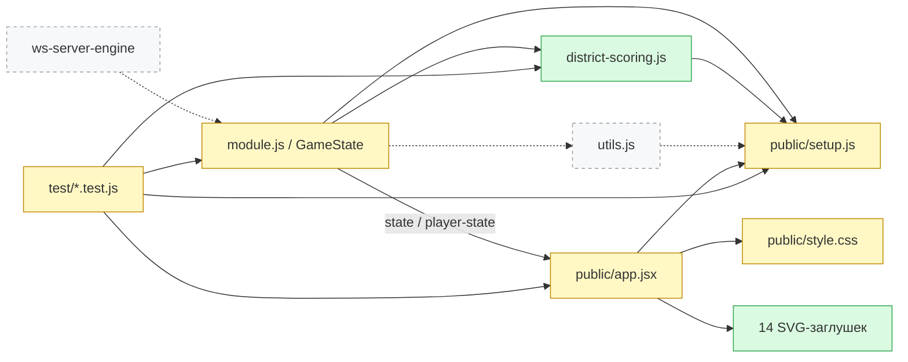

## 🗺 Карта сущностей

Проверен каталог доступных инструментов: отдельного локального рендера диаграмм нет; инструмент визуализаций Pages публикует внешний документ и не подходит для локального ревью. Карта приведена в Mermaid. Ссылки ведут в рабочую копию: изменения на момент ревью ещё не были закоммичены.

🟩 новый · 🟨 изменён · 🟥 удалён · ⬚ связанный (не в MR); сплошная — связь в MR, пунктир — вне MR

| Файл | Тип | Изменение | Кто зависит | Тесты |
|---|---|---|---|---|
| module.js | Машина игры | M | Хост, клиент событий | start-game, district-actions, district-rounds, district-acquisitions |
| public/setup.js | Общий каталог и правила | M | Сервер, utils, scorer, клиент | setup, setup-expansion, party-settings, storage |
| district-scoring.js | Подсчёт очков | A | GameState | district-scoring |
| public/app.jsx | Интерфейс и события | M | Игровая страница | setup-client, client-expansion, браузер |
| public/style.css | Представление | M | Игровая страница | Браузер desktop/mobile |
| public/cards/placeholders | Временные рисунки | A | Карточки | Браузер, атрибуция |
| utils.js | Колода | rel | GameState | deck, utils |
| package.json | Состав пакета | M | Хост при установке | scorer включён в files |

---

## 🔎 Findings

Независимое ревью выполнено свежим изолированным агентом по текущему diff и утверждённой спецификации. Открытых подтверждённых дефектов после исправлений не осталось.

| ID | Severity | Найдено и исправлено | Где |
|---|---|---|---|
| F1 | 🟡 P2 | Терялся выбранный экземпляр Некрополя/Логова с индивидуальной скидкой; сохранён индекс, включая финансирование Некрополя Кардиналом. | [module.js:1858](../../module.js#L1858), [app.jsx:1992](../../public/app.jsx#L1992) |
| F2 | 🟡 P2 | Исчезал автор отложенного запрета после разрушения Палаты; источники сохраняются и отображаются. | [module.js:952](../../module.js#L952), [app.jsx:1461](../../public/app.jsx#L1461) |
| F3 | 🟡 P2 | Убитый Император мог применить квартал при внеочередной передаче короны; закрыто сервером и интерфейсом. | [module.js:940](../../module.js#L940), [app.jsx:1483](../../public/app.jsx#L1483) |
| F4 | 🟡 P2 | Чертог обходил оплату Кардиналом; обычная постройка и копия теперь поддерживают её с оплатой исходной карты. | [module.js:1595](../../module.js#L1595), [app.jsx:1763](../../public/app.jsx#L1763) |
| F5 | 🟡 P2 | Финальный визуальный просмотр обнаружил перекрытие номинала кнопкой увеличения на мобильном экране; кнопка перенесена на рисунок. | [style.css:1715](../../public/style.css#L1715) |

### Test Gaps

TEST1 — закрыт: восстановление открытого просмотра Башни и тайм-аут добавлены в [регрессионный тест](../../test/district-actions.test.js#L207). Сохранность колоды/сброса и использованной отметки подтверждена также независимым сценарием.

### Questions

Q1 — закрыт: проверка увеличения выявила существовавший в HEAD конфликт mousedown/click, сразу закрывавший карту после открытия. Открытие перенесено на click ([app.jsx:155](../../public/app.jsx#L155)); это отдельный прежний дефект интерфейса.

### NIT

Нет.

---

## 🗺 Scope & Risk

🏷 **Тип:** mixed (product-feature + docs + tests) · 📊 **Риск:** 🔴 high

- 🎯 **Концентрация изменений:** игровой цикл, строительство, способности экземпляров и интерфейс выбора.
- 🧪 **Покрытие тестами:** общие правила, server events/snapshots, клиентские события и браузер; результаты полного прогона в отдельном отчёте проверки. Независимо сверены 6 144 комбинации очков с полным перебором.
- 💥 **Blast-radius:** общий setup используют utils, GameState, scorer и браузер; изменения затрагивают большинство способов строительства и передачи кварталов.
- 🖐 **Проверить руками:** длительная партия с комбинациями нескольких одинаковых построек, таймерами, переподключением и передачей источников отложенных действий.
- 🚀 **Риски релиза:** новые необязательные поля snapshots и событий; старые параметры поддерживаются, стандартные колоды сохранены. Нужно обновлять весь пакет и перезапускать сервер; старый сервер не понимает новые способности. Откат к прежнему серверу требует сохранения совместимого снимка партии.
- 📊 **Уровень риска:** 🔴 high из-за объёма изменений правил и игрового цикла, несмотря на автоматические проверки.

### 🏛 Архитектура

Общие вычисления цены, размера города, дохода и повторок находятся в setup, итоговые очки — в отдельном серверном scorer. Обратных зависимостей на интерфейс нет. Закрытые цели и просмотр остаются в private player-state; публичные состояния содержат только источники и статусы. Новых подтверждённых архитектурных дефектов не найдено.

### 👥 Кто нужен на ревью

CODEOWNERS/platform.yml не обнаружены, поэтому команды не назначаются.

- **model** — каталог, GameState, подсчёт очков и снимки.
- **view-model** — выбор экземпляров, проверки целей, сериализация событий и редактор сетапа.
- **view** — карточки, статусы и мобильные действия.

---

## 🧭 Code intro

1. [module.js:985](../../module.js#L985) — общая проверка строительства и оплата исходной карты.
2. [module.js:439](../../module.js#L439) — очередь Театров и переход к ходу.
3. [public/setup.js:387](../../public/setup.js#L387) — общие расчёты и ограничения, используемые сервером и клиентом.
4. [district-scoring.js:51](../../district-scoring.js#L51) — очки каждого экземпляра и независимый выбор цветов Призраков.
5. [public/app.jsx:1461](../../public/app.jsx#L1461) — источники эффектов и кнопки отдельных построек; далее выбор Чертога и Кардинала (F4).
