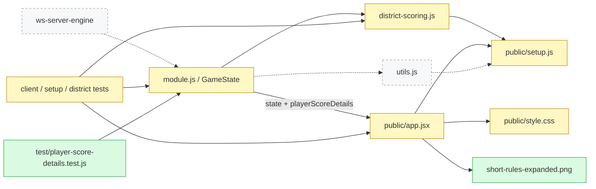

## 🗺 Карта сущностей

Проверены доступные инструменты визуализации: локального diagram-render tool нет; Pages создаёт внешний документ, а visualize предписывает Mermaid для статической структуры. Карта встроена в отчёт. Ссылки ведут в рабочую копию: проверены незакоммиченные изменения относительно `829afb0fd71e0fdf49826ef8fce23ebff6526ad1`, а не неизменённые строки этого коммита.

🟩 новый · 🟨 изменён · 🟥 удалён · ⬚ связанный (не в MR); сплошная — связь в MR, пунктир — вне MR

| Файл | Тип | Изменение | Кто зависит | Тесты |
|---|---|---|---|---|
| district-scoring.js | Расчёт суммы и составляющих очков | M | GameState, тесты расчёта | district-scoring |
| module.js | Публичное состояние, snapshots, источники запрета | M | Хост, клиент | player-score-details, district-actions |
| public/app.jsx | Редактор, карточки, выбор и подсказки | M | Игровая страница | client-expansion, setup-client; адресный render-smoke |
| public/setup.js | Тексты общей валидации | M | Сервер, scorer, utils, клиент | setup-client |
| public/style.css | Подсветки, прозрачность, положение подсказок | M | Игровая страница | Браузерная проверка основного QA |
| test/player-score-details.test.js | Контракт публичных очков и snapshots | A | node:test | 3 сценария |
| test/{client-expansion,district-actions,district-scoring,setup-client}.test.js | Регрессии изменённого поведения | M | node:test | В составе 69 адресных сценариев |
| public/short-rules-expanded.png | Изображение памятки | A | ShortRules | Содержимое арта не входит в это независимое ревью |
| README.md, docs/design и docs/qa | Требования и протокол | M | Читатель проекта | Сверка требований |
| utils.js | Создание колоды | rel | GameState | Существующий тест нескольких Мостов |

---

## 🔎 Findings

Clean-room: ревью выполнил отдельный агент без истории реализации. Проверены diff, актуальная спецификация и последние уточнения, затем исправления найденных проблем. Production-код ревьюер не редактировал. **Открытых подтверждённых дефектов после повторной проверки нет.**

| ID | Severity | Найдено и исправлено | Где |
|---|---|---|---|
| F1 | 🟡 P2 | Просмотр валидного импортированного сетапа с несколькими Мостами сворачивал количество в одну карточку; теперь выводит каждый экземпляр. Проверены количества 0/1/2/99 и уникальность ключей. | [app.jsx:1417](<//wsl.localhost/Ubuntu/home/ivan/Code/citadels-web/public/app.jsx:1417>) |
| F2 | 🟡 P2 | После передачи Палаты публичный статус соединял имя инициатора с индексом карты в чужом городе; теперь отдельно называет инициатора и текущего владельца, без номера. Проверены перенос, отсутствие переноса, старый источник без sourceSlot и разрушение. | [app.jsx:1537](<//wsl.localhost/Ubuntu/home/ivan/Code/citadels-web/public/app.jsx:1537>), [module.js:957](<//wsl.localhost/Ubuntu/home/ivan/Code/citadels-web/module.js:957>) |

### Test Gaps

| ID | Что не проверяется постоянными тестами | Где |
|---|---|---|
| TEST1 | DOM-цепочка удержания/отпускания, положение подсказки у границ окна, hover/focus/Escape и контраст подсветок требуют браузерного прогона; VM-тесты методов не доказывают визуальный результат. В этом независимом проходе браузерные действия не выполнялись; основной QA проверяет их отдельно. | [app.jsx:99](<//wsl.localhost/Ubuntu/home/ivan/Code/citadels-web/public/app.jsx:99>), [app.jsx:412](<//wsl.localhost/Ubuntu/home/ivan/Code/citadels-web/public/app.jsx:412>) |

Адресный read-only smoke реального JSX через установленный Babel подтверждает F1/F2 после исправления; этот smoke не добавлялся в постоянный набор тестов.

### Questions

— нет открытых. Ограничение переключателя Моста значениями 0/1 подтверждено как согласованное поведение редактора; импортированные количества сохраняются до намеренного изменения выбора. Удержание с закрытием при отпускании — явное требование, поэтому оно не считается регрессией.

### NIT

— нет.

### Выполненные проверки

- WSL/Linux Node: `node --test test/player-score-details.test.js test/district-scoring.test.js test/client-expansion.test.js test/district-actions.test.js test/setup-client.test.js` — **69 PASS, 0 FAIL**.
- Независимое сравнение нового и прежнего scorer из `829afb0`: **10 000 составов городов**, случайные украшения, выдержка, экспозиции, руки, золото, корона и бонус разноцвета — сумма не изменилась; сумма компонентов всегда равна total.
- Реальный JSX с Babel: адресные render-проверки F1/F2 — PASS.
- `git diff --check` — PASS.
- Проверены отсутствие Secret Vault в публичной расшифровке до финала, финальный бонус, восстановление старого snapshot, сброс расшифровки на новой игре; повторные клики Дипломата и Чертога не отправляют событий.
- Новый PNG и его prompt находились в отдельной работе с генерацией арта; качество, полнота и точность текста изображения этим отчётом не подтверждаются.

---

## 🗺 Scope & Risk

🏷 **Тип:** mixed (product-feature + fixes + docs + tests) · 📊 **Риск:** 🟡 medium

### ⚠️ Риск

- 🎯 **Концентрация изменений** — клиентские карточки и редактор; отдельная существенная часть — единый серверный расчёт суммы и публичной расшифровки.
- 🧪 **Покрытие тестами** — 69 адресных сценариев и 10 000 независимых сравнений прошли; визуальные ограничения см. TEST1.
- 💥 **Blast-radius** — scorer вызывает GameState; `playerScoreDetails` читает CityScoreHelp; `sourceSlot` потребляют подсветка карточки и статус эффекта. Вызовы общего setup остаются совместимыми.
- 🖐 **Проверить руками** — TEST1, несовместимый Театр после импорта, подсветку custom face Дипломата, активную Палату у наблюдателя после переноса и актуальное изображение памятки.
- 🚀 **Риски релиза** — публичный state получает аддитивное поле; старые snapshots пересчитываются после нормализации. Нужен перезапуск серверного хоста для module.js/setup.js. Новых зависимостей или формата экспортируемого setup нет.
- 📊 **Уровень риска** — 🟡 medium: доменный результат подтверждён сравнением; основной остаточный риск находится в браузерном взаимодействии и новом арте.

### 🏛 Архитектура

Проверка требуется из-за изменения модели очков и публичного state. Подтверждённых архитектурных дефектов нет. Total и breakdown получаются из одной функции; клиент не повторяет доменный расчёт. Тайные названия карт руки не публикуются до окончания партии. Новое поле sourceSlot отделяет местоположение постройки от инициатора эффекта; его потребители согласованы после F2.

### 👥 Кто нужен на ревью

CODEOWNERS/platform.yml не обнаружены; персональные владельцы не назначаются.

- **model** — scorer, восстановление snapshot, публичность данных, источники эффектов.
- **view-model** — снятие выбора, сортировка, импортированное количество Мостов, жизненный цикл подсказок.
- **view** — карточки, подсветки, позиции подсказок и памятка.

---

## 🧭 Code intro — куда смотреть первым

1. [district-scoring.js:58](<//wsl.localhost/Ubuntu/home/ivan/Code/citadels-web/district-scoring.js:58>) — единый расчёт номинала, бонусов и размера города.
2. [module.js:923](<//wsl.localhost/Ubuntu/home/ivan/Code/citadels-web/module.js:923>) и [module.js:1919](<//wsl.localhost/Ubuntu/home/ivan/Code/citadels-web/module.js:1919>) — граница публичной расшифровки и восстановление снимков.
3. [app.jsx:1417](<//wsl.localhost/Ubuntu/home/ivan/Code/citadels-web/public/app.jsx:1417>) и [app.jsx:1537](<//wsl.localhost/Ubuntu/home/ivan/Code/citadels-web/public/app.jsx:1537>) — исправленные края F1/F2.
4. [app.jsx:99](<//wsl.localhost/Ubuntu/home/ivan/Code/citadels-web/public/app.jsx:99>) и [app.jsx:412](<//wsl.localhost/Ubuntu/home/ivan/Code/citadels-web/public/app.jsx:412>) — карточные и итоговые подсказки, TEST1.
5. [app.jsx:1772](<//wsl.localhost/Ubuntu/home/ivan/Code/citadels-web/public/app.jsx:1772>) и [app.jsx:2098](<//wsl.localhost/Ubuntu/home/ivan/Code/citadels-web/public/app.jsx:2098>) — локальное снятие выбора до отправки игровых событий.
